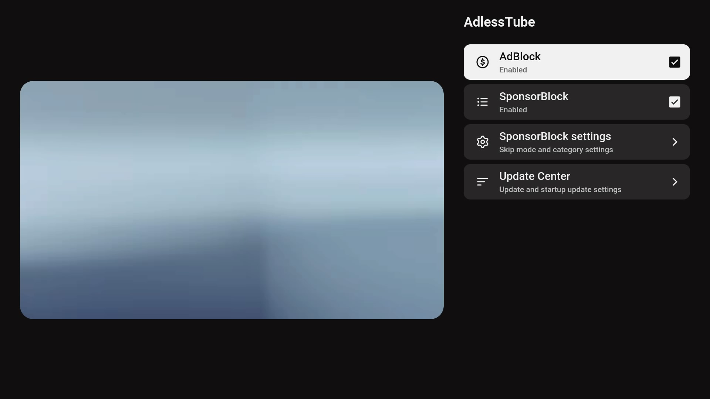
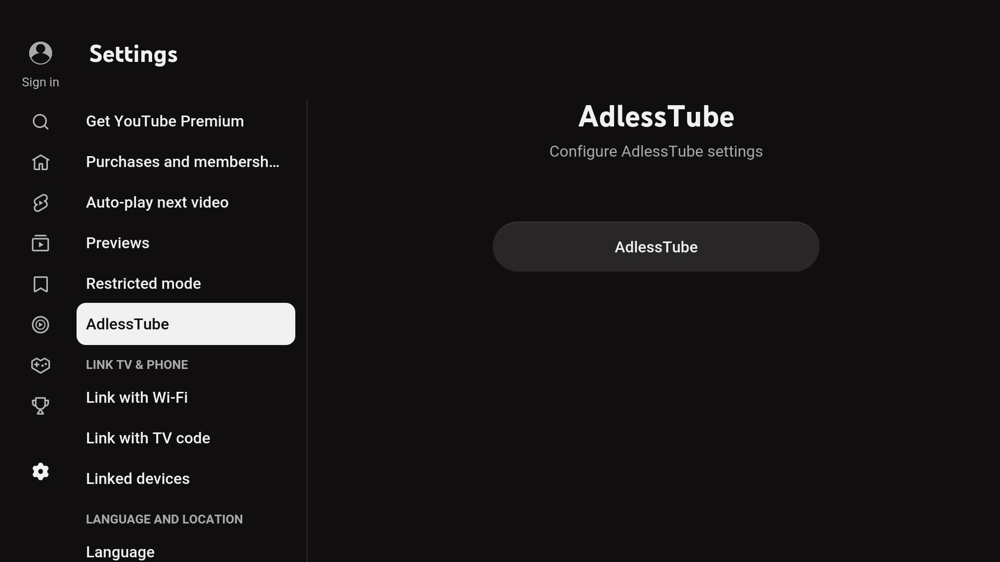
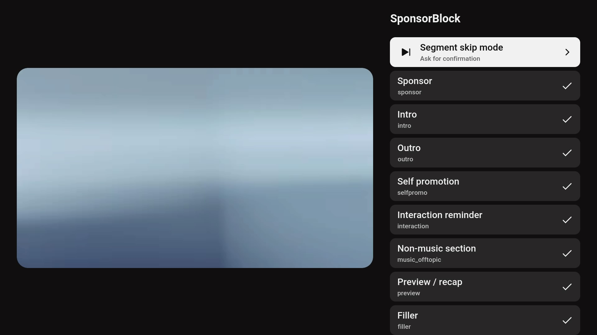
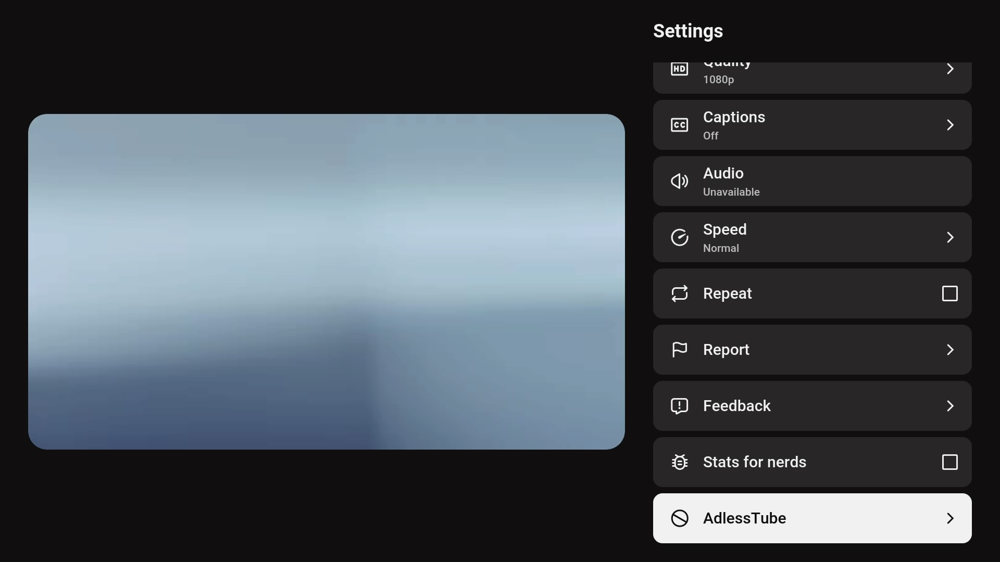

# AdlessTube

A GoldHEN plugin that blocks ads and skips sponsored segments on the PS4 YouTube  app.

**Compatible with:** YouTube v02.32 from pkg-zone.com (CUSA01015)

## Features


- ✅ Automatic ad skipping
- ✅ SponsorBlock integration - skip sponsored segments, intros, outros, and more
- ✅ Enable or disable AdBlock and SponsorBlock independently
- ✅ Three SponsorBlock skip modes: automatic, silent automatic, or confirmation
- ✅ All changes take effect immediately - no YouTube restart required
- ✅ Native YouTube TV toast notifications
- ✅ Plugin settings integrated into YouTube's native menus
- ✅ Update Center with manual update checks and optional startup update checking
- ✅ Local HTTP proxy server for SponsorBlock API access


## Installation

For easier installation, use the [AdlessTube Installer](https://github.com/FourZeroCode/PS4-YT-AdBlock-SponsorBlock-Installer). It simplifies the setup, so you can skip the manual steps below.

1. **Download the plugin**
   - Download `ps4_yt_adsponsorblock.prx` from the [latest release](https://github.com/FourZeroCode/ps4_yt_adsponsorblock/releases)

2. **Copy to your PS4**
   - Copy `ps4_yt_adsponsorblock.prx` to `/data/GoldHEN/plugins/` on your PS4

3. **Configure GoldHEN**
   - Edit `/data/GoldHEN/plugins.ini` to add the following:
   ```ini
   [CUSA01015]
   /data/GoldHEN/plugins/ps4_yt_adsponsorblock.prx
   ```

4. **Restart YouTube**
   - Close and reopen the YouTube app.
   - You should see an **AdlessTube** toast notification when the plugin loads.

The plugin creates `/data/youtube/config.json` on first launch if it does not already exist. You do not need to download or create it manually.

## Optional Configuration

The plugin automatically creates `/data/youtube/config.json` at first launch if it is missing. You can change these settings in YouTube’s native menus or edit the config file directly. The file contains the same settings for AdBlock, SponsorBlock, enabled SponsorBlock categories, and segment skip behavior. Configuration-file editing is optional.

If you edit the file, restart YouTube for the changes to take effect.

- **AdBlock:** Enable or disable ad skipping.
- **SponsorBlock:** Enable or disable SponsorBlock segment detection and skipping.
- **Categories:** Include a category name in the `categories` array to enable it. Remove the name to disable it.
- **Skip mode:** Set `skipMode` to:
  - `auto` — automatically skip matching segments and show a toast notification.
  - `silent` — automatically skip matching segments without a toast notification.
  - `confirm` — ask for confirmation before skipping a matching segment.

By default, all SponsorBlock categories are enabled and matching segments are skipped automatically.

### Available SponsorBlock Categories


Use these exact category names in the `categories` array. Remove a name to disable that category, or add it back to enable it.

| Category | What it covers |
|---|---|
| `sponsor` | Paid sponsorships and sponsored promotions within a video. |
| `selfpromo` | Creators promoting their own products, services, or projects. |
| `interaction` | Requests to like, subscribe, or otherwise interact with the channel. |
| `intro` | The opening section of a video before its main content. |
| `outro` | The ending section of a video after its main content. |
| `preview` | Previews or teasers of upcoming content within the video. |
| `music_offtopic` | Music that is unrelated to the main topic of the video. |
| `filler` | Filler or tangential content that is not relevant to the main topic. |
| `hook` | An opening hook intended to grab the viewer's attention before the main content. |
| `poi_highlight` | Highlights of a point of interest, such as a notable moment or location. |
| `exclusive_access` | Content showing access or material available exclusively through a promotion or arrangement. |
| `chapter` | Chapter transitions or sections identified as chapter segments. |

Category labels and intended use follow SponsorBlock's category definitions. The exact segments skipped depend on the submitted segment data and how each segment is categorized.

## Native YouTube Menus


AdlessTube settings are integrated into YouTube’s native Settings and video-player menus.

The Update Center provides a manual update check and an option to check for updates when YouTube starts. Startup checking uses a cooldown to avoid checking GitHub on every launch. You can also run a manual check whenever you want.

## How it Works

### Ad Skipping

The plugin hooks into the YouTube Cobalt app's HTML script execution engine and injects custom JavaScript that detects and skips ads automatically.

### SponsorBlock Integration

The plugin creates a local HTTP proxy server on `localhost:4040` that:

1. Receives requests from the injected JavaScript
2. Fetches segment data from the SponsorBlock API using PS4's native HTTP library
3. Returns the data to JavaScript
4. Displays a toast with segment information, lets you skip or continue watching, or skips automatically, depending on your configuration

This approach bypasses Cobalt browser's XHR security restrictions without needing CSP bypass.

## Toast Notifications

You'll see native YouTube TV toast notifications for:

- **Plugin loaded:** When YouTube loads
- **Segments found:** When SponsorBlock segments are detected (e.g., "SponsorBlock: 3 segment(s) found")
- **Segment skipped:** When a segment is automatically skipped (e.g., "Segment Skipped: sponsor (15s)")

The release build logs GitHub update downloads only.

## Technical Details

- Hooks `HTMLScriptExecute` at address `0x0097fb40`
- Local HTTP proxy server on port 4040
- Uses PS4 native networking (`sceNet`, `sceHttp`, `sceSsl`)
- JavaScript injection via local buffer for stability
- SponsorBlock API: https://sponsor.ajay.app

## Building from Source

Make sure `$OO_PS4_TOOLCHAIN` is in your PATH (see OpenOrbis for install and setup instructions).

```bash
cd GoldHEN_Plugins_Repository/plugin_src/ps4_yt_adsponsorblock
./build.sh
```

The compiled plugin will be in `../../bin/plugins/prx_final/ps4_yt_adsponsorblock.prx`.

### Debug Build

To enable debug logging:

```bash
DEBUG=1 ./build.sh
```

## Credits

- Original yt_adskip_ps4 by [earthonion](https://github.com/earthonion/yt_adskip_ps4)
- Built using the [GoldHEN Plugins SDK](https://github.com/GoldHEN/GoldHEN_Plugins_SDK)
- Built using [OpenOrbis PS4 Toolchain](https://github.com/OpenOrbis/OpenOrbis-PS4-Toolchain)
- SponsorBlock API by [Ajay Ramachandran](https://sponsor.ajay.app)
- Toast notification implementation inspired by TizenTube

## License

MIT License - See LICENSE file for details
